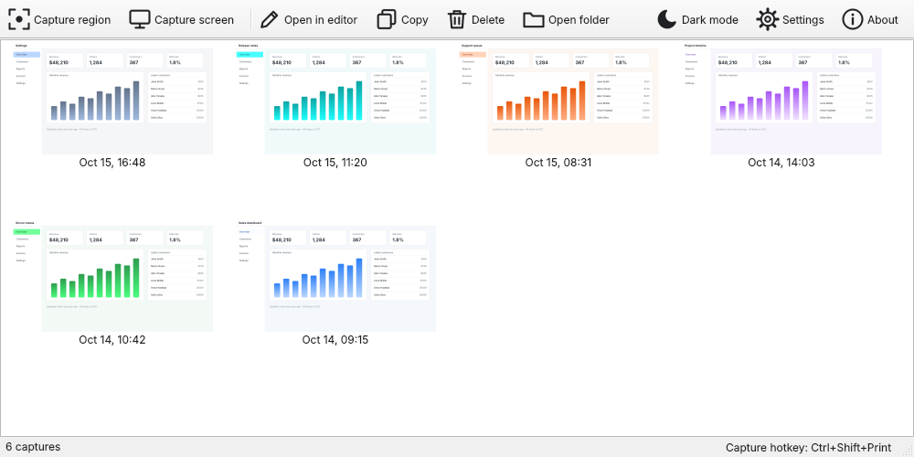
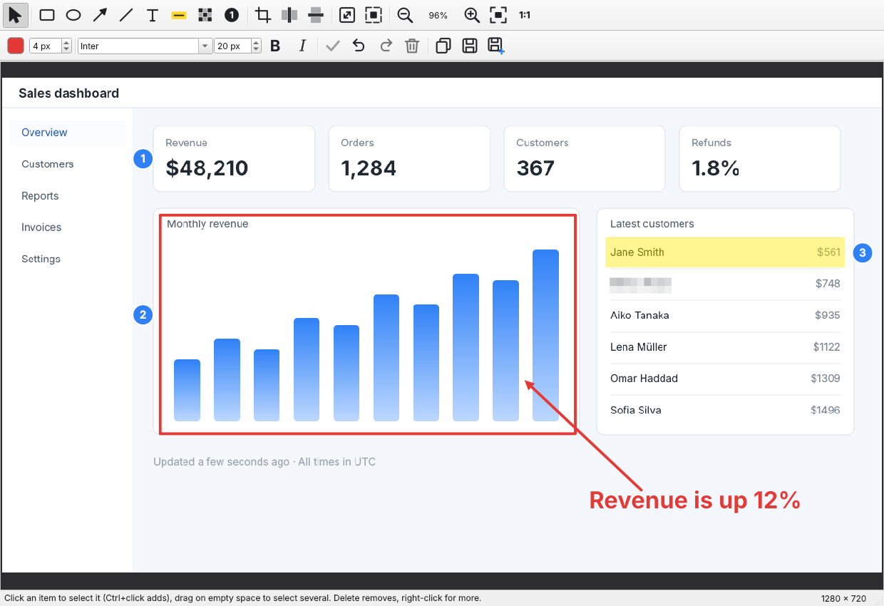

# ScreenCapture

A simple, free screen capture tool for Windows and Linux. Capture a region or a window, add annotations, crop,
resize, and keep your screenshots in a library. Output is flattened PNG. MIT licensed.





*(Sample captures, drawn for this page.)*

**Contents:** [Install](#install) · [Quick start](#quick-start) · [Capturing](#capturing) · [The editor](#the-editor) ·
[The library](#the-library) · [Settings](#settings) · [Tray icon](#tray-icon) · [Command line](#command-line) ·
[Where things are stored](#where-things-are-stored) · [About and licence](#about-and-licence) · [Troubleshooting](#troubleshooting) · [Development](#development)

**Supported:** Windows 10/11 and Linux with an X11 session (Linux Mint, Ubuntu, …). Not supported yet: Wayland sessions
and macOS (see [Development](#development)).

## Install

### Linux (Mint / Ubuntu)

```bash
sudo apt install python3-venv libxcb-cursor0
wget -qO- https://github.com/jtylek/ScreenCapture/releases/latest/download/screencapture-linux.tar.gz | tar xz
cd screencapture && ./install.sh --autostart
```

That's it: start **ScreenCapture** from the menu (or run `screencapture`). To update, run the same commands again.

- The installer works for your user only, no `sudo`. It sets up a private Python environment in
  `~/.local/share/screencapture` (needs internet), a `screencapture` command in `~/.local/bin` and a menu entry.
- `--autostart` is optional: it starts the app quietly in the tray at login, which the capture hotkey needs.
- If the `screencapture` command is not found right after installing, log out and back in.
- Set your capture hotkey in **Library → Settings** (gear icon); see [Settings](#settings) for using PrintScreen.
  Alternative that always works: add a custom system shortcut with the command `~/.local/bin/screencapture --capture`.
- **Uninstall:** `cd screencapture && ./uninstall.sh` (`--purge` also deletes your saved screenshots).

### Windows

**[Download ScreenCapture-Setup.exe](https://github.com/jtylek/ScreenCapture/releases/latest/download/ScreenCapture-Setup.exe)**
(always the latest release; older versions are on the [Releases](https://github.com/jtylek/ScreenCapture/releases) page) and run it. It installs per user
(no admin needed) and optionally adds a desktop shortcut and start-at-login. Set the capture hotkey in
**Library → Settings** (gear icon). If you want PrintScreen and Windows already uses it for the Snipping Tool, turn
that off in *Settings → Accessibility → Keyboard → Use the Print screen button to open screen capture*.

Build the installer yourself on Windows (needs Python 3.9+ and [Inno Setup](https://jrsoftware.org/isinfo.php)):

```powershell
powershell -ExecutionPolicy Bypass -File packaging\build_windows.ps1
```

Pushing a `v*` tag, or running **Actions → Build installers**, builds the installer and the Linux bundle in GitHub
Actions and attaches them to a release.

## Quick start

1. Start ScreenCapture. It lives in the system tray and opens the **Library** window.
2. Press your capture hotkey (default **Ctrl+Shift+Print**), or click **Capture region** in the Library.
3. Drag a rectangle over what you want, or just click a window.
4. The capture is saved to the library and opens in the **editor**: add arrows, boxes, text, blur, crop.
5. **Copy** it to the clipboard (Ctrl+Shift+C) to paste it somewhere, or **Save** it back to the library (Ctrl+S).

## Capturing

Start a capture with the hotkey, the **Capture region** button, the tray menu, or `screencapture --capture`. The screen
freezes and dims, and the app's own windows get out of the way.

| Do this | Result |
|---|---|
| Move the mouse over a window | The window is highlighted |
| **Click** | Captures the highlighted window |
| **Drag** | Captures the rectangle you drag. A label shows its size in pixels |
| **Esc** or **right-click** | Cancels |

- With several monitors, every monitor is dimmed and you choose on any of them. A selection stays on one monitor.
- A capture cancels itself after 60 seconds without mouse activity, when the computer goes to sleep, and when monitors
  are added or removed, so the dimmed screen can never get stuck.
- **Capture full screen** (tray menu or Library → *Capture screen*) takes the whole monitor the mouse is on.
  **Capture full screen in 3 s** waits three seconds first, so you can open a menu or hover a tooltip.
- Captures are saved at the monitor's real pixel size, also on scaled / high-DPI displays.
- The new capture is added to the [library](#the-library) and opened in the editor at once.

## The editor

The top row holds the tools, resize and zoom, the second row the style, edit and save buttons. Hover any button for its name.

### Drawing tools

Pick a tool, then drag on the image (Text and Step: click).

| Tool | What it does |
|---|---|
| **Select** | Click an item to select it, drag it to move it. Drag on empty space to select several |
| **Rectangle** / **Ellipse** | Outline shapes |
| **Arrow** / **Line** | Drag from the start to the end. The arrow head is at the end |
| **Text** | Click where the text should go and type. Click elsewhere or press Esc to finish. Double-click a text with the Select tool to edit it |
| **Highlight** | A translucent yellow marker over an area |
| **Blur** | Pixelates the part of the screenshot under it, to hide names, numbers or passwords |
| **Step** | A numbered circle (1, 2, 3, …) for step-by-step instructions. Click to place the next number |

Style controls (second row), applied to what you draw next:

- **Color** button opens a color picker. **Line width** (1–40 px) applies to rectangles, ellipses, arrows and lines.
- **Text font**, **text size** (6–300 px), **Bold** and **Italic**. They apply to new text *and* to the text items you have
  selected.

### Selecting, moving and deleting

- Click an item to select it (Ctrl+click adds to the selection), or drag a box around several. **Ctrl+A** selects all.
- Drag selected items to move them.
- Remove them with the **Delete** key, the **trash** button, or right-click → **Delete**. Right-click also offers
  **Select all** and **Delete all annotations**.
- **Undo** (Ctrl+Z) and **Redo** (Ctrl+Y or Ctrl+Shift+Z) cover everything: drawing, moving, deleting, text styling, crop and cut.

### Crop and cut out

- **Crop** – drag the area to keep. Drag its edges or corners to adjust, or its inside to move it. Press **Enter** or the
  green check button to apply, **Esc** to cancel.
- **Cut out a vertical strip** / **horizontal strip** – drag across the part you want to remove. A red hatched band
  shows what will go. Adjust its edges, then **Enter** or the check button. The two sides are joined together, so you can
  remove boring parts from the middle of a long capture. Annotations inside the removed strip are deleted, the ones
  beyond it move over. Undo brings everything back.

### Resize image and canvas size

- **Resize image** (Ctrl+R) scales the whole picture to a new size, in pixels or in percent. With *Keep aspect ratio* on
  (the default) changing the width changes the height too. Annotations are scaled together with the picture: their
  positions follow it, and rectangles, text, arrows and step circles keep their shape. If you turn the aspect ratio lock
  off and squash the picture, the annotations move with it but are not distorted.
- **Canvas size** (Ctrl+Shift+R) changes the size of the picture's *surface* without scaling the picture. Make it bigger to
  add empty space around the image (for example room for notes or arrows), or smaller to cut the edges off. Choose where
  the current image stays in the new canvas with the 3×3 position buttons, and the color of the added area. Annotations
  move with the image.
- Both open a small dialog with the current size, show the result before you press OK, and can be undone. Sizes are limited
  to 20 000 pixels per side and 120 megapixels in total.

### Zoom and pan

- Buttons next to the tools: **zoom out**, the current **percentage**, **zoom in**, **fit** (whole image in the window) and
  **1:1** (real pixels).
- **Ctrl + mouse wheel** zooms around the mouse. **Ctrl+`+`** / **Ctrl+`-`** step the zoom, **Ctrl+0** fits the image,
  **Ctrl+1** shows 100%. The range is 5%–1600%.
- A big capture opens fitted to the window and stays fitted when you resize it, until you zoom by hand.
- When zoomed in, **pan** by holding **Space** and dragging, or with the **middle mouse button**.

### Saving

| Button | Shortcut | What it does |
|---|---|---|
| **Copy** | Ctrl+Shift+C | Puts the image, with the annotations, on the clipboard |
| **Save** | Ctrl+S | Writes the result back to the library entry (replacing the original capture) |
| **Save as…** | Ctrl+Shift+S | Saves a PNG or JPEG anywhere you like |

The title bar shows an asterisk while there are unsaved changes, and closing the editor asks whether to save them to the
library. Edits are flattened into the PNG: reopening a saved capture shows one picture, not separate objects.

## The library

Every capture is saved automatically and shown as a thumbnail, newest first. The library keeps the **latest 500**
captures and removes older ones.

- **Double-click** (or select and press Enter) opens a capture in the editor again. **Open in editor** does the same.
- **Copy** puts the selected capture on the clipboard. **Delete** (also the Delete key) removes the selected captures
  after asking. Select several with Ctrl+click or Shift+click.
- Right-click a thumbnail for *Open in editor*, *Copy to clipboard* and *Delete*.
- **Open folder** shows the library folder in your file manager, so you can drag the PNG files into an email or a chat.
- **Capture region** and **Capture screen** start a capture from the library window.
- **About** shows the version, the licence and the project page (see below).
- The **sun / moon** button switches between light and dark mode. The status bar shows the capture count and your hotkey.

## Settings

Open **Library → Settings** (gear icon). OK saves, Cancel undoes the changes. Theme and icon size preview while you pick them.

- **Theme** – follow the system, light or dark.
- **Icon size** – small, medium (default) or large toolbar icons.
- **Startup** – start ScreenCapture quietly in the tray when you sign in to Windows / Linux, so the hotkey is always ready.
- **Capture hotkey** – a global shortcut that starts a region / window capture from any application. Click the box and press
  the keys. **Clear** turns the hotkey off, **Default** restores `Ctrl+Shift+Print`. It works on Windows and Linux/X11
  (not Wayland). `Ctrl+Alt+letter` is refused because it is AltGr on many keyboards. If the combination is already taken,
  the dialog says so.

Using **PrintScreen** as the hotkey:

- **Linux Mint:** the system holds that key for its own screenshot tool. Clear the system screenshot
  shortcut under *Keyboard → Shortcuts* first. ScreenCapture tells you when a key is taken.
- **Windows:** Windows may be holding PrintScreen for the Snipping Tool. Turn that off under
  *Settings → Accessibility → Keyboard → Use the Print screen button to open screen capture*.

## Tray icon

The icon in the system tray (menu bar area) opens the Library when clicked. Its menu has **Capture region / window**,
**Capture full screen**, **Capture full screen in 3 s**, **Library**, **Settings…**, **About** and **Quit**. Closing the Library or
editor windows keeps the app running in the tray (when your desktop has one); use **Quit** to stop it.

## Command line

| Command | Does |
|---|---|
| `screencapture` | Opens the Library |
| `screencapture --capture` | Starts a region / window capture |
| `screencapture --fullscreen` | Captures the monitor under the mouse |
| `screencapture --library` | Shows the Library |
| `screencapture --tray` | Starts quietly in the tray (used for start at login) |
| `screencapture --quit` | Stops the running instance |

Only one instance runs: these commands talk to the one that is already running, so they are what keyboard shortcuts and
launchers should call.

## Where things are stored

| | Linux | Windows |
|---|---|---|
| Captures (PNG) | `~/.local/share/ScreenCapture/ScreenCapture/library/` | `%APPDATA%\ScreenCapture\ScreenCapture\library\` |
| Log file | `~/.local/share/ScreenCapture/ScreenCapture/screencapture.log` | `%APPDATA%\ScreenCapture\ScreenCapture\screencapture.log` |

The library's **Open folder** button opens the captures folder. Settings are kept in the usual per-user place (the registry
on Windows, `~/.config/ScreenCapture/` on Linux).

## About and licence

ScreenCapture is **free software** by **Janusz Tylek**, released under the **[MIT license](LICENSE)**: you may use, copy,
modify and share it, also commercially, as long as the licence text stays with it. **Library → About** shows the version
and this information.

Updates, help and bug reports: **https://github.com/jtylek/ScreenCapture**

## Troubleshooting

ScreenCapture writes a log (including Python tracebacks if it ever crashes hard) to the log file above. Attach it when
reporting a problem. On Linux you can also run `screencapture` in a terminal to see errors directly.

- **The hotkey does nothing / "key is taken":** another program or the system owns that combination, see
  [Settings](#settings). Pick another one, or bind a system shortcut to `screencapture --capture`.
- **Capture overlay stuck:** press Esc or right-click. It also cancels itself after 60 seconds of inactivity.
- **Fatal Python error: none_dealloc (Linux):** PySide6 6.12.0 has a bug that crashes Python versions older than 3.12
  (Linux Mint 21 / Ubuntu 22.04 ship 3.10), so the installer picks an older working PySide6 there. If you installed
  earlier, run `~/.local/share/screencapture/venv/bin/pip install "PySide6-Essentials<6.12"` or simply run `./install.sh` again.

## Development

```bash
pip install -e ".[dev]" && QT_QPA_PLATFORM=offscreen pytest
```

The sample screenshots above are regenerated from the real windows with `docs/make_screenshots.py`
(`xvfb-run -a -s "-screen 0 1700x1100x24" env PYTHONPATH=. python docs/make_screenshots.py`).

Not implemented yet: Wayland (needs the xdg-desktop-portal screenshot API), macOS (window capture, the global hotkey,
start at login, an app bundle and the Screen Recording permission flow are missing), resizing handles on existing
annotations, scrolling capture.
